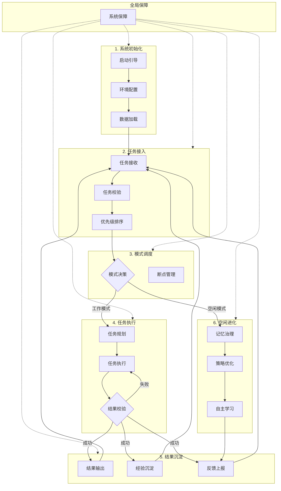

# 多层级自主智能体系统 - 产品需求文档

## 1. 产品概述

一个高度模块化的多层级自主智能体系统，采用分层架构设计，实现从系统初始化、任务接入、模式调度、任务执行、结果沉淀到空闲进化的完整生命周期管理。

**核心价值**：
- 7层清晰职责划分，每层独立又相互协作
- 支持任务抢占与断点恢复，确保高可用
- 智能空闲进化机制，持续自我优化
- 实时状态反馈与监控告警

## 2. 核心功能

### 2.1 系统层级架构

| 层级 | 核心职责 | 输入 | 输出 |
|------|---------|------|------|
| 1. 系统初始化 | 一次性启动准备 | 启动命令、配置文件 | 运行环境、记忆/策略/知识库 |
| 2. 任务接入 | 统一任务入口 | 外部任务、持久化任务 | 优先级排序后的任务 |
| 3. 模式调度 | 系统中枢决策 | 任务队列、系统状态 | 工作/空闲指令、断点管理 |
| 4. 任务执行 | 任务全流程处理 | 任务、历史经验 | 执行结果、成功/失败判定 |
| 5. 结果沉淀 | 输出结果+沉淀经验 | 执行结果、执行日志 | 标准化结果、更新数据、实时反馈 |
| 6. 空闲进化 | 无任务时自我提升 | 记忆库、策略库、知识库 | 优化后的记忆、策略、新知识 |
| 全局保障 | 全程高可用 | 各层状态、异常信号 | 保活、自愈、备份、监控 |

### 2.2 功能模块

1. **系统初始化层**
   - 启动引导模块
   - 环境配置模块
   - 数据加载模块

2. **任务接入层**
   - 任务接收器
   - 任务校验器
   - 任务优先级排序器

3. **模式调度层**
   - 模式决策器（工作/空闲）
   - 断点管理器
   - 抢占切换器

4. **任务执行层**
   - 任务规划器
   - 任务执行器
   - 结果校验器

5. **结果沉淀层**
   - 结果输出器
   - 经验沉淀器
   - 反馈上报器

6. **空闲进化层**
   - 记忆治理模块
   - 策略优化模块
   - 自主学习模块

7. **全局保障层**
   - 系统保障模块（保活、自愈、备份、监控）

## 3. 核心流程

## 4. 用户界面设计

### 4.1 设计风格
- **整体风格**：深色科技感 + 霓虹光效，展现智能系统的未来感
- **配色方案**：
  - 主色：#0a0e27（深空蓝黑）
  - 强调色：#00f5ff（电光蓝）、#ff6b35（能量橙）
  - 层级别色：渐变蓝色系区分各层级
- **字体**：JetBrains Mono（代码风格）+ Noto Sans SC（中文）
- **布局**：垂直层级瀑布流 + 动态连线动画

### 4.2 页面设计

| 模块 | UI元素 |
|------|--------|
| 层级卡片 | 玻璃拟态卡片、发光边框、层级指示图标 |
| 任务流程 | 动态虚线连接、脉冲动画 |
| 状态指示 | 呼吸灯效果、状态徽章 |
| 实时监控 | 数据流可视化、进度条、统计面板 |
| 空闲进化 | 神经网络动画、知识图谱展示 |

### 4.3 响应式设计
- 桌面端优先，支持平板和移动端查看
- 核心数据面板自适应布局
