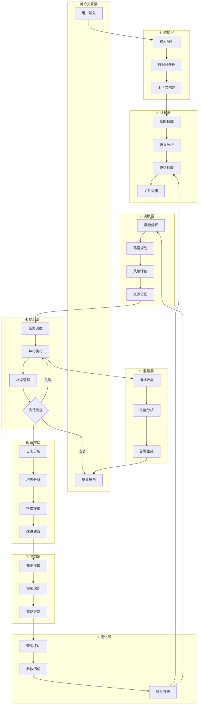

# 多层级自主智能体系统 - 全新阶段产品需求文档

## 1. 产品概述

一个高度模块化、可进化、具备真实学习能力的多层级自主智能体系统，采用高级架构设计，实现从感知、认知、决策、执行、反思到进化的完整智能周期。

**核心价值**：
- 8+2层级清晰职责划分，每层具备独立智能能力又相互协作
- 支持高级模式调度（工作、学习、进化、休眠、修复）
- 深度学习与强化学习的自主进化机制
- 实时性能监控与异常自愈能力
- 全链路可观测与可视化调试系统

## 2. 核心功能

### 2.1 用户角色

| 角色 | 注册方式 | 核心权限 |
|------|----------|---------|
| 系统管理员 | 本地配置 | 全功能访问、配置管理 |
| 高级用户 | 无需注册 | 任务管理、系统监控、测试运行 |
| 观察者 | 只读访问 | 查看运行状态、查看历史数据 |

### 2.2 功能模块

#### 全新层级系统（8+2架构）

| 层级 | 核心职责 | 输入 | 输出 |
|------|---------|------|------|
| 1. 感知层 | 多模态输入处理 | 用户指令、API数据、环境状态 | 标准化感知数据 |
| 2. 认知层 | 理解与推理 | 感知数据、历史知识 | 理解结果、推理链路 |
| 3. 决策层 | 智能规划与决策 | 认知结果、目标、约束 | 执行计划、决策方案 |
| 4. 执行层 | 任务执行与调度 | 决策方案、可用资源 | 执行结果、状态更新 |
| 5. 监控层 | 实时监控与告警 | 系统状态、性能指标 | 告警、异常报告 |
| 6. 反思层 | 事后分析与总结 | 执行结果、反馈数据 | 经验总结、改进建议 |
| 7. 学习层 | 知识提取与更新 | 反思结果、外部知识 | 更新后的知识库 |
| 8. 进化层 | 系统自我优化 | 学习成果、性能数据 | 优化后的策略、架构改进 |
| A. 全局保障 | 高可用保障 | 各层状态、异常信号 | 自愈、备份、监控 |
| B. 集成层 | 外部系统对接 | API调用、数据同步 | 集成状态、数据交换 |

#### 功能特性

1. **感知层**
   - 多模态输入处理器
   - 数据流解析器
   - 信号预处理器
   - 上下文组装器

2. **认知层**
   - 意图理解器
   - 语义分析器
   - 关系图谱构建器
   - 记忆检索器

3. **决策层**
   - 目标分解器
   - 路径规划器
   - 风险评估器
   - 资源分配器

4. **执行层**
   - 任务调度器
   - 并行执行引擎
   - 状态机管理
   - 中断处理

5. **监控层**
   - 实时指标收集
   - 性能基线管理
   - 告警引擎
   - 可视化展示

6. **反思层**
   - 执行日志分析
   - 错误根因分析
   - 成功模式提取
   - 改进建议生成

7. **学习层**
   - 知识提取器
   - 模式识别器
   - 策略更新器
   - 知识库维护

8. **进化层**
   - 架构评估器
   - 参数调优器
   - 组件升级器
   - A/B测试框架

9. **全局保障**
   - 系统监控模块
   - 数据备份模块
   - 故障恢复模块
   - 安全保障模块

10. **集成层**
    - REST API接口
    - WebSocket实时通信
    - 事件总线
    - 插件系统

### 2.3 页面详情

| 页面名称 | 模块名称 | 功能描述 |
|---------|---------|---------|
| 系统仪表盘 | 状态概览面板 | 系统整体状态、关键指标、各层级状态 |
| 系统仪表盘 | 实时监控图表 | CPU、内存、任务执行速度、成功率等实时图表 |
| 系统仪表盘 | 事件时间线 | 系统事件的时间序列展示 |
| 任务管理 | 任务列表 | 所有任务的管理、过滤、搜索 |
| 任务管理 | 任务详情 | 单个任务的完整执行链路和结果 |
| 任务管理 | 任务提交 | 新任务的创建、配置和提交 |
| 知识管理 | 记忆库浏览 | 系统记忆的结构化展示和查询 |
| 知识管理 | 策略编辑器 | 系统策略的查看和编辑 |
| 知识管理 | 知识图谱 | 知识关系的可视化展示 |
| 测试中心 | 综合测试运行器 | 各种测试场景的自动化运行 |
| 测试中心 | 压力测试配置 | 自定义压力测试参数配置 |
| 测试中心 | 性能基准测试 | 系统性能基准的建立和对比 |
| 配置管理 | 系统配置 | 各种系统参数的调整和保存 |
| 配置管理 | 主题设置 | 界面主题、颜色方案的自定义 |
| 配置管理 | 插件管理 | 系统插件的安装、配置、卸载 |
| 报告中心 | 运行报告 | 系统运行的各种统计和分析报告 |
| 报告中心 | 性能报告 | 性能指标的详细分析和建议 |
| 报告中心 | 进化历程 | 系统进化的历史记录和对比 |

## 3. 核心流程

## 4. 用户界面设计

### 4.1 设计风格

- **整体风格**：未来感科技风格，深空黑背景搭配霓虹渐变，体现智能系统的高级感
- **配色方案**：
  - 主色：#0a0e27（深空蓝黑）
  - 强调色：#00f5ff（电光蓝）、#ff6b35（能量橙）、#a855f7（神秘紫）
  - 辅助色：#10b981（数据绿）、#ef4444（警示红）、#f59e0b（警告黄）
  - 层级别色：从深蓝到紫色的渐变色系区分各层级
- **字体**：
  - 标题：Orbitron（科技感）
  - 正文：Inter（高可读性）
  - 代码：JetBrains Mono（等宽）
- **图标风格**：
  - 使用Lucide React图标库
  - 线性图标为主，搭配渐变填充
  - 图标尺寸标准化（16px, 20px, 24px）
- **按钮样式**：
  - 圆角：8-16px
  - 悬停效果：霓虹发光边框 + 背景渐深
  - 按压效果：轻微下沉动画
  - 禁用样式：半透明灰色
- **布局风格**：
  - 网格布局 + 弹性布局混合
  - 左侧导航栏 + 内容区 + 右侧面板
  - 玻璃拟态效果的卡片式设计

### 4.2 页面设计概述

| 页面名称 | 模块名称 | UI元素 |
|---------|---------|---------|
| 系统仪表盘 | 状态概览面板 | 渐变背景、玻璃拟态卡片、发光边框、状态呼吸灯、实时数据刷新动画 |
| 系统仪表盘 | 实时监控图表 | 流式图表、数据点脉冲动画、交互式悬停提示、多图表联动 |
| 任务管理 | 任务列表 | 虚拟滚动列表、状态徽章、进度条、批量操作工具栏、筛选器 |
| 任务管理 | 任务详情 | 层级式信息展示、执行时间线、数据流动画、结果对比面板 |
| 知识管理 | 知识图谱 | 力导向布局图、节点连线动画、节点悬停详情、缩放平移控制 |
| 测试中心 | 综合测试运行器 | 场景选择卡片、进度环形图、实时日志流、性能指标实时更新 |
| 配置管理 | 系统配置 | 表单式布局、分组折叠面板、实时验证反馈、一键重置按钮 |

### 4.3 响应式设计

- **桌面端**：三列布局（导航240px + 内容 + 面板320px）
- **平板端**：两列布局（导航折叠 + 内容 + 面板可切换）
- **移动端**：单列布局，底部导航，面板抽屉式展示
- **触摸优化**：按钮最小48px，滑动手势支持，点击反馈动画

### 4.4 动画与交互

- **页面加载**：Staggered入场动画，元素依次出现
- **数据刷新**：平滑过渡动画，避免页面抖动
- **状态变化**：脉冲动画突出重要变更
- **任务执行**：时间线流动动画，进度条平滑变化
- **错误提示**：弹性弹出动画，红色警示边框
- **成功反馈**：绿色对勾动画，庆祝效果
- **导航切换**：平滑过渡动画，视差效果
- **模态框**：缩放淡入，背景模糊效果

### 4.5 特殊视觉效果

- **玻璃拟态**：背景模糊 + 半透明 + 毛玻璃效果
- **霓虹发光**：边框发光、文字发光、按钮发光
- **粒子效果**：背景粒子、数据传输粒子、装饰性粒子
- **流动渐变**：背景渐变缓慢流动，制造动态感
- **涟漪效果**：点击时的涟漪扩散动画
