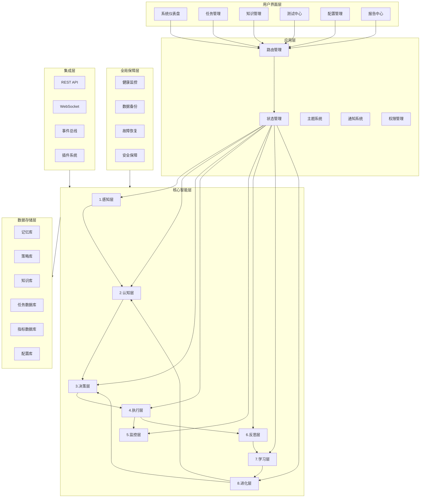
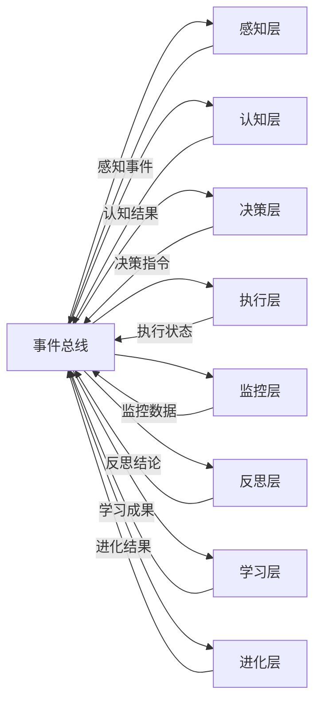

# 多层级自主智能体系统 - 全新阶段技术架构文档

## 1. 架构设计



## 2. 技术栈说明

### 2.1 前端技术
- **前端框架**：React@18 + TypeScript
- **UI库**：Tailwind CSS v3 + 自定义组件系统
- **状态管理**：Zustand
- **构建工具**：Vite
- **动画效果**：Framer Motion + CSS动画
- **图标**：Lucide React
- **图表库**：Recharts
- **日期处理**：date-fns
- **通知系统**：Sonner
- **路由**：React Router
- **表单处理**：React Hook Form
- **数据验证**：Zod

### 2.2 后端技术（可选）
- **后端框架**：Express.js（如需要）
- **数据库**：Supabase (PostgreSQL)
- **实时通信**：WebSocket
- **认证**：JWT

### 2.3 核心库与工具
- **数据结构**：Immutable.js
- **工具函数**：Lodash-es
- **异步处理**：RxJS（事件流）
- **测试框架**：Vitest
- **类型检查**：TypeScript
- **代码格式化**：Prettier + ESLint

## 3. 路由定义

| 路径 | 页面 | 功能 |
|------|------|------|
| / | 系统仪表盘 | 系统整体状态展示 |
| /dashboard | 仪表盘 | 详细状态监控 |
| /tasks | 任务管理 | 任务列表与详情 |
| /tasks/:id | 任务详情 | 单个任务的完整信息 |
| /knowledge | 知识管理 | 记忆库、策略库、知识库 |
| /knowledge/graph | 知识图谱 | 可视化知识关系 |
| /testing | 测试中心 | 综合测试运行器 |
| /testing/stress | 压力测试 | 压力测试配置与运行 |
| /testing/benchmark | 基准测试 | 性能基准测试 |
| /config | 配置管理 | 系统配置、主题设置 |
| /config/plugins | 插件管理 | 插件的安装与配置 |
| /reports | 报告中心 | 运行报告、性能报告、进化历程 |

## 4. 数据模型

### 4.1 核心类型定义

```typescript
// 层级状态
interface LayerState {
  id: number;
  name: string;
  status: 'idle' | 'active' | 'processing' | 'error' | 'recovering';
  metrics: {
    cpuUsage: number;
    memoryUsage: number;
    taskCount: number;
    avgResponseTime: number;
    successRate: number;
  };
  lastUpdate: number;
  modules: string[];
}

// 任务类型
interface Task {
  id: string;
  name: string;
  description?: string;
  priority: 0 | 1 | 2 | 3 | 4; // 0=最低, 4=最高
  status: 'pending' | 'queued' | 'running' | 'completed' | 'failed' | 'interrupted';
  input: Record<string, any>;
  output?: Record<string, any>;
  error?: string;
  createdAt: number;
  queuedAt?: number;
  startedAt?: number;
  completedAt?: number;
  duration?: number;
  executorLayer?: number;
  metadata?: Record<string, any>;
  tags?: string[];
}

// 记忆类型
interface Memory {
  id: string;
  type: 'experience' | 'pattern' | 'knowledge' | 'error' | 'success';
  content: string;
  context?: Record<string, any>;
  relevance: number; // 0-1 相关性得分
  embedding?: number[]; // 向量嵌入
  createdAt: number;
  lastAccessed?: number;
  accessCount: number;
  tags?: string[];
}

// 策略类型
interface Strategy {
  id: string;
  name: string;
  description: string;
  version: string;
  conditions: Record<string, any>;
  actions: Record<string, any>;
  effectiveness: number; // 0-1 效果得分
  usageCount: number;
  successCount: number;
  createdAt: number;
  lastUpdated: number;
  isActive: boolean;
}

// 知识节点
interface KnowledgeNode {
  id: string;
  label: string;
  type: string;
  properties: Record<string, any>;
  embedding?: number[];
}

// 知识关系
interface KnowledgeEdge {
  id: string;
  source: string;
  target: string;
  type: string;
  weight: number;
  properties: Record<string, any>;
}

// 知识图谱
interface KnowledgeGraph {
  nodes: KnowledgeNode[];
  edges: KnowledgeEdge[];
}

// 系统指标
interface SystemMetrics {
  totalTasks: number;
  completedTasks: number;
  failedTasks: number;
  successRate: number;
  avgResponseTime: number;
  maxResponseTime: number;
  minResponseTime: number;
  uptime: number;
  memoryUsage: number;
  cpuUsage: number;
  knowledgeGrowth: number;
  evolutionSteps: number;
}

// 系统模式
type SystemMode = 'work' | 'learning' | 'evolving' | 'sleeping' | 'repairing';

// 性能基准
interface PerformanceBenchmark {
  id: string;
  name: string;
  timestamp: number;
  metrics: Record<string, number>;
  configuration: Record<string, any>;
}
```

### 4.2 状态管理结构

```typescript
interface SystemStore {
  // 系统基础状态
  systemMode: SystemMode;
  isRunning: boolean;
  startTime: number;
  
  // 层级状态
  layers: LayerState[];
  
  // 任务管理
  tasks: Task[];
  currentTask: Task | null;
  taskQueue: Task[];
  
  // 知识与记忆
  memories: Memory[];
  strategies: Strategy[];
  knowledgeGraph: KnowledgeGraph;
  
  // 系统指标
  metrics: SystemMetrics;
  benchmarks: PerformanceBenchmark[];
  
  // 通知与错误
  notifications: Notification[];
  lastError: string | null;
  storageWarning: boolean;
  
  // Actions
  setSystemMode: (mode: SystemMode) => void;
  startSystem: () => void;
  stopSystem: () => void;
  
  addTask: (task: Partial<Task>) => Task;
  updateTask: (id: string, updates: Partial<Task>) => void;
  removeTask: (id: string) => void;
  executeTask: (taskId: string) => Promise<void>;
  batchExecuteTasks: (taskIds: string[]) => Promise<void>;
  
  updateLayerStatus: (layerId: number, updates: Partial<LayerState>) => void;
  
  addMemory: (memory: Partial<Memory>) => Memory;
  updateMemory: (id: string, updates: Partial<Memory>) => void;
  retrieveRelevantMemories: (query: string, limit?: number) => Memory[];
  
  addStrategy: (strategy: Partial<Strategy>) => Strategy;
  updateStrategy: (id: string, updates: Partial<Strategy>) => void;
  getOptimalStrategy: (context: Record<string, any>) => Strategy | null;
  
  addKnowledgeNode: (node: Partial<KnowledgeNode>) => KnowledgeNode;
  addKnowledgeEdge: (edge: Partial<KnowledgeEdge>) => KnowledgeEdge;
  updateKnowledgeGraph: (updates: Partial<KnowledgeGraph>) => void;
  
  updateMetrics: (updates: Partial<SystemMetrics>) => void;
  addBenchmark: (benchmark: PerformanceBenchmark) => void;
  
  addNotification: (notification: Notification) => void;
  setLastError: (error: string | null) => void;
  
  // 持久化
  saveSystemState: () => Promise<void>;
  loadSystemState: () => Promise<void>;
  exportData: (type: 'full' | 'tasks' | 'knowledge') => string;
  importData: (data: string) => Promise<void>;
}
```

## 5. 核心模块架构

### 5.1 层间通信架构



### 5.2 事件总线设计

```typescript
interface Event {
  id: string;
  type: string;
  source: string;
  timestamp: number;
  payload: any;
  priority: number;
}

interface EventBus {
  subscribe: (type: string, handler: (event: Event) => void) => () => void;
  publish: (event: Omit<Event, 'id' | 'timestamp'>) => void;
  publishAsync: (event: Omit<Event, 'id' | 'timestamp'>) => Promise<void>;
  clear: () => void;
}
```

### 5.3 插件系统架构

```typescript
interface Plugin {
  id: string;
  name: string;
  version: string;
  description: string;
  author: string;
  
  // 生命周期
  install: (system: SystemAPI) => void;
  uninstall: () => void;
  activate: () => void;
  deactivate: () => void;
  
  // 扩展点
  extendLayer?: (layerId: number) => LayerExtension;
  extendTaskProcessor?: () => TaskProcessor;
  extendKnowledgeExtractor?: () => KnowledgeExtractor;
}

interface SystemAPI {
  registerTaskProcessor: (processor: TaskProcessor) => void;
  registerKnowledgeExtractor: (extractor: KnowledgeExtractor) => void;
  registerMetricCollector: (collector: MetricCollector) => void;
  addNotification: (notification: Notification) => void;
  getState: () => SystemStore;
  dispatch: (action: any) => void;
}
```

## 6. 性能优化方案

### 6.1 渲染优化

- **React.memo**：对于纯展示组件使用记忆化
- **Selector优化**：使用Zustand的createSelector避免不必要重渲染
- **虚拟滚动**：长列表使用react-window或自定义虚拟滚动
- **懒加载**：路由级和组件级懒加载
- **批次更新**：使用unstable_batchedUpdates优化多次状态更新

### 6.2 数据优化

- **数据压缩**：使用LZ-string压缩存储大量数据
- **LRU缓存**：常用数据使用LRU缓存策略
- **增量更新**：只更新变化的部分数据
- **分页加载**：大数据量分页加载

### 6.3 存储优化

- **IndexedDB**：大数据量使用IndexedDB存储
- **localStorage**：小量配置和状态使用localStorage
- **自动备份**：定期自动备份数据
- **数据清理**：定期清理过期数据

### 6.4 动画优化

- **CSS优先**：优先使用CSS animation和transition
- **GPU加速**：使用transform和opacity属性
- **动画节流**：减少不必要的动画帧
- **requestAnimationFrame**：复杂动画使用RAF

## 7. 错误处理与恢复

### 7.1 错误边界

```typescript
interface ErrorBoundaryProps {
  fallback: React.ReactNode;
  onError?: (error: Error, errorInfo: React.ErrorInfo) => void;
}

interface ErrorBoundaryState {
  hasError: boolean;
  error?: Error;
}
```

### 7.2 全局错误处理

- **未捕获Promise**：全局监听unhandledrejection
- **React错误**：错误边界捕获组件错误
- **存储错误**：降级处理存储失败
- **网络错误**：重试机制与离线处理

## 8. 测试策略

### 8.1 单元测试

- **工具**：Vitest + React Testing Library
- **覆盖率**：核心逻辑>80%，组件>60%
- **范围**：工具函数、自定义Hook、纯组件

### 8.2 集成测试

- **流程测试**：端到端任务执行流程
- **状态同步**：跨组件状态同步验证
- **边界测试**：各种边界情况处理

### 8.3 系统测试

- **压力测试**：大量任务并发处理
- **稳定性测试**：长时间运行验证
- **性能基准**：性能对比与回归

## 9. 部署与构建

### 9.1 构建配置

- **开发环境**：Vite开发服务器 + HMR
- **生产构建**：Tree-shaking + 代码分割 + 压缩
- **类型检查**：TypeScript类型检查
- **代码质量**：ESLint + Prettier

### 9.2 性能预算

- **首屏加载**：<2s (3G网络)
- **JS bundle**：<300KB gzipped
- **CSS bundle**：<50KB gzipped
- **Lighthouse得分**：>90
