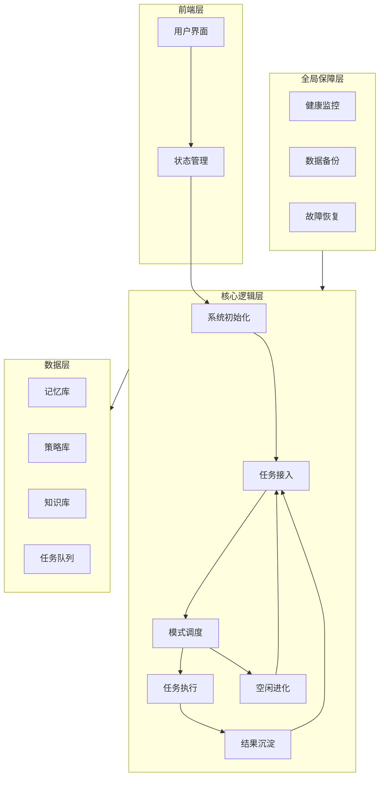

# 多层级自主智能体系统 - 技术架构文档

## 1. 架构设计



## 2. 技术选型

- **前端框架**：React@18 + TypeScript
- **UI库**：Tailwind CSS + 自定义组件
- **状态管理**：Zustand
- **构建工具**：Vite
- **动画效果**：CSS动画 + Framer Motion
- **图标**：Lucide React

## 3. 项目结构

```
src/
├── components/          # UI组件
│   ├── layers/         # 各层级可视化组件
│   ├── common/         # 通用组件
│   └── visualization/  # 数据可视化组件
├── hooks/              # 自定义Hooks
├── stores/             # Zustand状态管理
├── utils/              # 工具函数
├── types/              # TypeScript类型定义
├── pages/              # 页面组件
└── App.tsx             # 应用入口
```

## 4. 核心模块定义

### 4.1 类型定义

```typescript
interface Task {
  id: string;
  priority: number;
  status: 'pending' | 'running' | 'completed' | 'failed';
  input: any;
  output?: any;
  createdAt: number;
}

interface ExecutionResult {
  success: boolean;
  data?: any;
  error?: string;
  duration: number;
}

interface LayerState {
  status: 'idle' | 'active' | 'error';
  metrics: Record<string, number>;
  lastUpdate: number;
}

type SystemMode = 'work' | 'idle';
```

### 4.2 层级组件结构

| 组件 | 职责 | Props |
|------|------|-------|
| LayerCard | 层级卡片容器 | title, status, metrics |
| TaskFlow | 任务流程可视化 | tasks, currentTask |
| ModeIndicator | 模式状态指示 | mode, onSwitch |
| ProgressRing | 进度环形图 | value, max, label |
| StatusBadge | 状态徽章 | status, label |
| DataStream | 数据流动画 | data, direction |
| EvolutionPanel | 进化面板 | evolutionState |

### 4.3 状态管理结构

```typescript
interface SystemStore {
  mode: SystemMode;
  layers: Record<number, LayerState>;
  tasks: Task[];
  currentTask: Task | null;
  metrics: SystemMetrics;

  // Actions
  setMode: (mode: SystemMode) => void;
  addTask: (task: Task) => void;
  executeTask: (taskId: string) => Promise<void>;
  updateLayerStatus: (layerId: number, status: LayerState) => void;
}
```

## 5. 动画与交互设计

### 5.1 连接线动画
- 任务流程使用虚线流动动画
- 数据传输使用粒子效果
- 空闲进化使用波纹扩散效果

### 5.2 状态转换
- 层间切换使用淡入淡出
- 任务状态变更使用脉冲闪烁
- 错误状态使用红色警示动画

## 6. 性能优化

- 使用React.memo减少不必要的重渲染
- 状态更新使用Zustand的selector优化
- 动画使用CSS transform和opacity属性
- 大数据列表使用虚拟滚动
